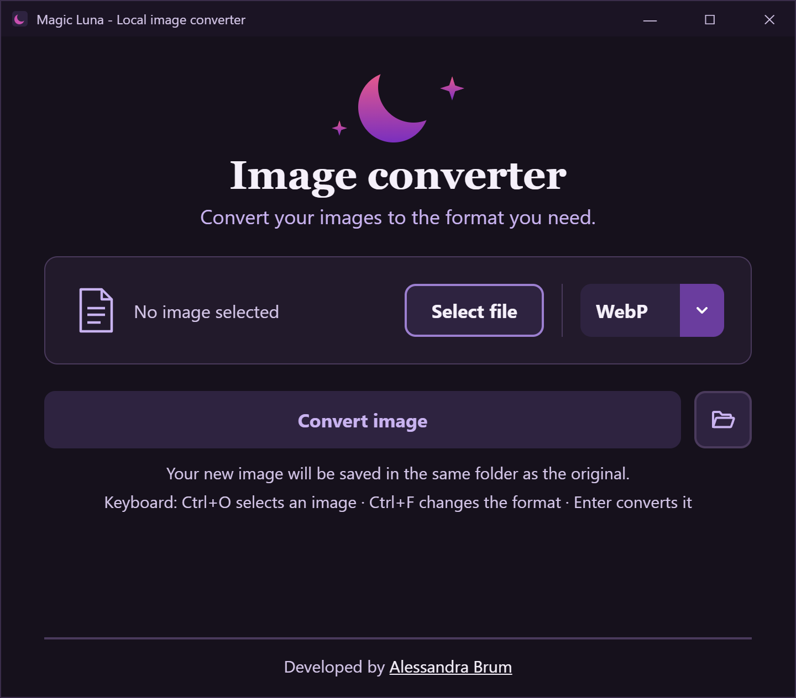

## 🌙 Magic Luna

Magic Luna is a downloadable Windows app that converts images between formats, right on your computer. ✨

- Version 1.2.0 is available now!
- Website: https://magicluna.alessandrabrum.com

### What's new since the first version

- **Many formats:** convert between WebP, PNG, JPG, GIF, BMP, TIFF, ICO, AVIF and PDF.
- **PDF support:** turn a PDF into images (one image per page) or turn images into a PDF.
- **Format menu:** choose the output format in the app, or press `Ctrl+F` to switch.
- **Open folder button:** after converting, open the folder with the new file selected (`Ctrl+E`).
- **File size before and after:** see how much space the new file takes.
- **Safe saving:** your original file is never overwritten.

### ⚠️ About the Windows security warning

Magic Luna is a small independent app and is not digitally signed yet. Because of this, Windows and your browser may show a warning the first time. This is expected and does not mean the app is harmful.

**If your browser says the file "isn't commonly downloaded":**
click the three dots next to the download and choose **Keep**.

**If Windows shows "Windows protected your PC":**
1. Click **More info**.
2. Click **Run anyway**.

You only need to do this once.

Magic Luna runs 100% on your computer: it does not connect to the internet and your images never leave your device. The full source code is open in this repository, so anyone can check what it does.

- [Full Changelog](https://github.com/AlessandraBrum/magic-luna-image-converter/commits/v1.2.0)

- [Check out the original prototype on Figma](https://www.figma.com/proto/yxyfUJRUgjRv0XiJgZaoV2/Magic-Luna-Converter-PNG-to-WebP-in-Python?node-id=13-177&t=fi1ELCBGUEikAC6F-0&scaling=min-zoom&content-scaling=fixed&page-id=0%3A1)

 

---
 

🌙 O Magic Luna é um app para Windows, que você baixa e usa no seu computador, para converter imagens entre formatos. ✨

A versão 1.2.0 já está disponível!

### Novidades desde a primeira versão

- **Vários formatos:** converta entre WebP, PNG, JPG, GIF, BMP, TIFF, ICO, AVIF, e PDF.
- **Suporte a PDF:** transforme um PDF em imagens (uma imagem por página) ou transforme imagens em um PDF.
- **Menu de formatos:** escolha o formato de saída no app, ou aperte `Ctrl+F` para trocar.
- **Botão de abrir a pasta:** depois de converter, abra a pasta com o novo arquivo selecionado (`Ctrl+E`).
- **Tamanho do arquivo antes e depois:** veja quanto espaço o novo arquivo ocupa.
- **Salvamento seguro:** o seu arquivo original nunca é sobrescrito.

### ⚠️ Sobre o aviso de segurança do Windows

O Magic Luna é um app independente e ainda não tem assinatura digital. Por isso, o Windows e o navegador podem mostrar um aviso na primeira vez. Isso é esperado e não significa que o app seja perigoso.

**Se o navegador disser que o arquivo "não é baixado com frequência":**
clique nos três pontinhos ao lado do download e escolha **Manter**.

**Se o Windows mostrar "O Windows protegeu o computador":**
1. Clique em **Mais informações**.
2. Clique em **Executar assim mesmo**.

Você só precisa fazer isso uma vez.

O Magic Luna funciona 100% no seu computador: ele não se conecta à internet e suas imagens nunca saem do seu dispositivo. O código-fonte completo está aberto neste repositório, então qualquer pessoa pode conferir o que ele faz.

